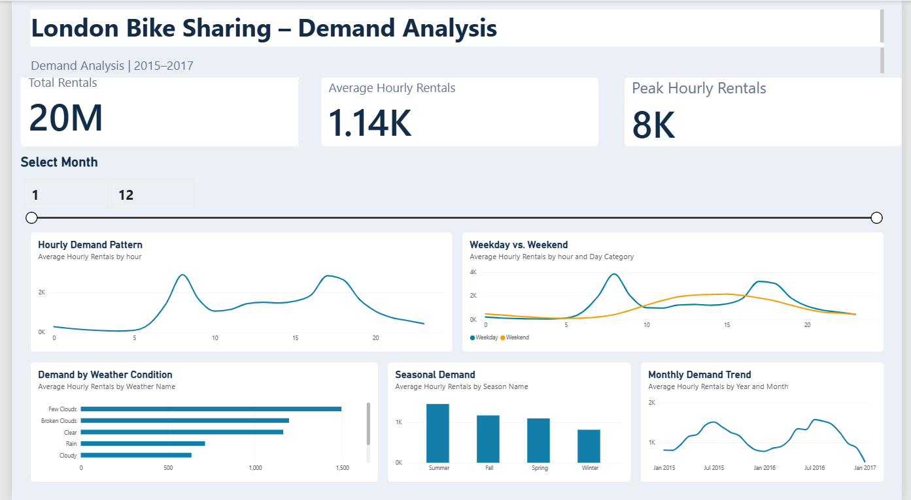

# London Bike Sharing – Demand Analysis

## Project Overview
This project investigates hourly bike-sharing demand in London using historical rental, weather, and calendar data. It combines descriptive statistics, exploratory data analysis (EDA), and an interactive Power BI report to identify demand patterns and support operational planning.

## Dashboard


## Business Objectives
- Identify peak and off-peak rental periods.
- Compare weekday and weekend demand patterns.
- Examine seasonal, monthly, and weather-related variations.
- Translate analytical findings into practical operational recommendations.

## Dataset
The dataset contains 17,414 observations and 10 original variables, covering January 4, 2015 through January 3, 2017. Each observation represents an hourly rental count with associated weather and calendar information.

| Variable | Description |
|---|---|
| timestamp | Observation date and time |
| cnt | Number of bike rentals |
| t1 | Temperature |
| t2 | Feels-like temperature |
| hum | Humidity |
| wind_speed | Wind speed |
| weather_code | Weather category |
| is_holiday | Holiday indicator |
| is_weekend | Weekend indicator |
| season | Season category |

## Tools & Technologies
- Python and pandas: data inspection, preparation, and statistical analysis
- Matplotlib: exploratory visualization
- Jupyter Notebook: analytical workflow
- Power BI: interactive reporting and visualization

## Data Cleaning & Preparation
- Inspected data types, descriptive statistics, unique values, and variable ranges.
- Confirmed zero missing values and zero duplicate rows in the original dataset.
- Converted timestamps to datetime, weather and season codes to categorical variables, and calendar indicators to Boolean values.
- Identified 30 intervals exceeding one hour; no missing-hour imputation was performed.
- Extracted hour, month, and day-of-week features, producing a dataset with 13 columns.
- Exported the prepared dataset for visualization.

## Exploratory Data Analysis
The analysis covers the distribution of rental counts, average hourly demand, weekday versus weekend patterns, seasonal demand, weather categories, monthly trends, and Pearson correlations between demand and numerical weather variables.

## Key Findings

| Metric | Value |
|---|---:|
| Total rentals | 19,905,972 |
| Mean hourly rentals | 1,143.10 |
| Median hourly rentals | 844 |
| Standard deviation | 1,085.11 |
| Minimum hourly rentals | 0 |
| Maximum hourly rentals | 7,860 |
| Skewness | 1.326 |

- Rental demand is right-skewed and varies considerably across observed hours.
- Weekdays exhibit distinct morning and evening peaks, around 8 AM and 5–6 PM, while weekend demand is more concentrated around midday and afternoon.
- Summer records the highest average hourly demand and winter the lowest.
- Monthly trends show recurring seasonal variation. January 2017 is only partially observed and should not be interpreted as a complete month.
- The dashboard shows higher average demand under few-cloud conditions than under rain or cloudy conditions.

### Correlation Analysis
| Variable | Pearson correlation with rentals |
|---|---:|
| Temperature | 0.389 |
| Feels-like temperature | 0.369 |
| Humidity | -0.463 |
| Wind speed | 0.116 |

Humidity has the strongest absolute linear association among the four weather variables examined. These correlations describe associations, not causal effects.

## Recommendations
- Prioritize bike availability and redistribution ahead of weekday commuting peaks.
- Adjust weekend operations to accommodate midday and afternoon demand.
- Plan capacity around higher summer demand and schedule maintenance during suitable lower-demand periods.
- Incorporate weather information into operational planning and evaluate its usefulness alongside calendar patterns.

## Repository Structure
```text
London-Bike-Sharing-Demand/
├── data/
│   ├── london_merged.csv
│   └── london_bikes_cleaned.csv
├── notebooks/
│   └── analysis.ipynb
├── dashboard/
│   └── London_Bike_Sharing_Dashboard.pbix
├── images/
│   └── london_bike_dashboard.png
└── README.md
```

## How to Run
1. Clone or download this repository.
2. Install the Python dependencies: `pip install pandas matplotlib jupyter`.
3. Open `notebooks/analysis.ipynb` in Jupyter. The current notebook uses local CSV filenames; when running from the notebooks directory, update the input path to `../data/london_merged.csv` and the output path to `../data/london_bikes_cleaned.csv`.
4. Run the notebook cells in order.
5. Open the `.pbix` file using Power BI Desktop. If refreshing the data, update its source path to the cleaned CSV on your machine.

## Limitations
This is a descriptive and exploratory analysis, not a predictive model or causal study. Irregular timestamp intervals and partial boundary months should be considered when interpreting temporal summaries. Weather-category comparisons are descriptive and do not control for confounding factors.

## Author
**Sultan Alharbi**

[Portfolio](https://sultan98d.github.io/) | [LinkedIn](https://www.linkedin.com/in/sultan-alharbi-34a5261b0)
